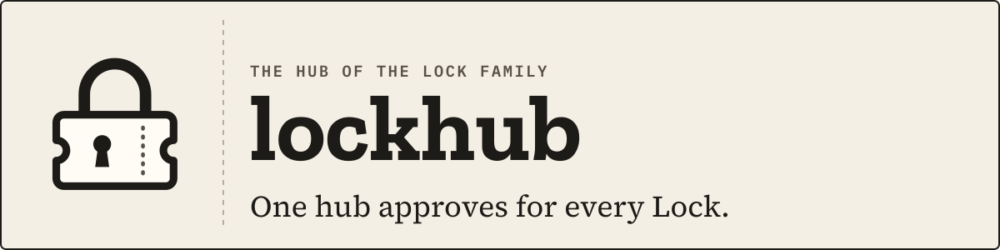

<p align="center">
  <picture>
    <source media="(prefers-color-scheme: dark)" srcset="docs/assets/banner-dark.svg">
    
  </picture>
</p>

<p align="center">
  <a href="https://github.com/DavidGodefroid/lockhub/actions/workflows/ci.yml"></a>
  <a href="https://github.com/DavidGodefroid/lockhub/releases"></a>
  <a href="LICENSE"></a>
  <a href="go.mod"></a>
</p>

<p align="center">
  <b>One hub approves for every Lock: <code>lox run</code> decides outside your<br>
  AI agent's harness, signs every decision, and never sees a value in clear.</b>
</p>

<p align="center">
  
</p>

<p align="center">
  <a href="#quick-start">Quick start</a> ·
  <a href="#how-it-works">How it works</a> ·
  <a href="#documentation">Docs</a> ·
  <a href="#the-lock-family">Lock Family</a>
</p>

---

lockhub is the approval hub of the [Lock Family](https://github.com/DavidGodefroid/lockfamily),
harness security for AI agents. Each Lock sends it a masked ticket; `lox run`
decides it, and the hub signs the decision.

The Lock executes only on a signed decision bound to the exact plan that was
approved. The hub never runs a request, never sees its results, and never
sees values in clear.

> [!NOTE]
> **Early development.** This repository holds the hub server (`lockhub serve`)
> and the host CLI `lox` (`lox init`, `lox add`, `lox run`, `lox approve`, `lox audit`, …).

## Why lockhub

- **Approvals live outside the agent's harness.** `lox run` is the one
  terminal you keep open, outside lea and any agent: an agent's own tool is
  never where its approvals are shown or answered.
- **One place for every Lock.** locksql, lockmq, lockfile, lockhttp and
  locklog all send their tickets to the same hub.
- **Reads flow, risky actions wait.** Auto mode approves reads by rule and
  asks you for writes, connections, dangerous actions and policy loosening.
- **Every decision is signed and audited,** without a value in clear.

## Install

```sh
brew trust davidgodefroid/tap
brew install davidgodefroid/tap/lox
```

Or everything at once (lea, `lox` and the Locks' launchers):

```sh
brew trust davidgodefroid/tap
brew install davidgodefroid/tap/lockfamily
```

Homebrew asks you to trust a third-party tap once before it loads its
formulas. Other ways:

- the Lock Family [install.sh](https://github.com/DavidGodefroid/lockfamily)
  installs the static `lox` archives (cosign-signed `checksums.txt`) into `~/.local/bin`;
- the hub ships as the cosign-signed image `ghcr.io/davidgodefroid/lockhub`,
  pinned by digest (`lox run` starts it for you).

Details: [docs/getting-started.md](docs/getting-started.md#what-a-release-ships).

## Quick start

1. In your project (or lea's projects directory), check the prerequisites
   and write a `lockfamily.yaml` with the hub alone:

   ```sh
   lox init
   ```

2. Add one data source, guided and applied at once:

   ```sh
   lox add locksql      # or lockmq, lockfile, lockhttp, locklog
   ```

3. Keep `lox run` open in a terminal of its own: it serves the decisions.

   ```sh
   lox run
   ```

4. Start your agent (claude, codex, gemini, …) in the project, or `lea`.
   A lock added while lea runs reaches it at lea's next start (`lea stop`, then `lea`).

Where to run each command, with or without lea:
[docs/getting-started.md](docs/getting-started.md).

## Highlights

<table>
<tr>
<td width="50%" valign="top">

**🧭 Outside the harness**<br>
`lox run` starts (or reuses) the hub and the workspace's locks, then shows
every ticket live: agent, lock, profile, masked request, decision, result.

</td>
<td width="50%" valign="top">

**⚡ Auto mode by default**<br>
Reads pass by rule; writes, DDL, dangerous actions, grants and policy
loosening are asked. A connection is asked once per profile per session.
**Shift+Tab** switches to manual.

</td>
</tr>
<tr>
<td valign="top">

**✍️ Signed, bound decisions**<br>
The lock signs its ticket, the hub signs the decision. `lox audit` lists
every exchange with both signatures; `lox audit verify` checks the whole chain.

</td>
<td valign="top">

**🙈 Never in clear**<br>
Masked screens everywhere. A reveal is sealed to your terminal (the hub
relays ciphertext); a paired phone signs its own decisions (WebAuthn).

</td>
</tr>
</table>

## How it works

```
agent → lock (socket) → hub (masked ticket) → lox run → hub (signed decision) → lock → agent
```

- A Lock no longer needs a human at its own terminal: it sends the hub an
  approval ticket, a masked screen of the request.
- `lox run` decides it: by its auto-mode rules, or by you in its terminal.
  `lox approve`, the lea deck, Slack, Telegram or a paired phone can answer too.
- The hub signs the decision, and the Lock checks the signature before it runs anything.
- Each lock (but lockhttp, whose egress is its own policy) reaches only the
  endpoints of its reviewed profile; `lox doctor` checks it.

The auto-mode rules, the keys of `lox run`, grants, production tickets and
reveals: [docs/approvals.md](docs/approvals.md).

### Supported locks

| Lock | Source | `lox add` | Since |
|---|---|---|---|
| [locksql](https://github.com/DavidGodefroid/locksql) | PostgreSQL, MySQL, MariaDB, SQLite | `lox add locksql` | v0.11.0 |
| [lockmq](https://github.com/DavidGodefroid/lockmq) | RabbitMQ | `lox add lockmq` | v0.3.0 |
| [lockfile](https://github.com/DavidGodefroid/lockfile) | S3, SFTP, a local directory | `lox add lockfile` | v0.4.0 |
| [lockhttp](https://github.com/DavidGodefroid/lockhttp) | HTTP, through lea's gate | `lox add lockhttp` | v0.3.0 |
| [locklog](https://github.com/DavidGodefroid/locklog) | this host's log files, journal and containers; Loki, Elasticsearch, OpenSearch | `lox add locklog` | v0.2.0 |

"Since" is each lock's first release that runs under `lox run` (hub mode);
`lox run` upgrades a pinned image older than the release this lox ships
with. locklog's mount plan:
[docs/lox-run.md](docs/lox-run.md#locklog-the-mount-plan-and-the-containers-map).

## Safety model

- The hub never runs a request, never sees its results, and never sees values in clear.
- A Lock executes only on a decision signed by the hub key it pinned, bound
  to the exact plan that was approved.
- Chat facades (Slack, Telegram) show masked screens only and answer only
  non-production reads and writes; a `lockfamily.yaml` can narrow this routing, never widen it.
- Quitting `lox run` stops serving decisions: pending tickets wait at the
  hub for the next `lox run` (fail closed).
- Whoever can open the facade socket is the host's human: your host
  account, never an agent container.

Details and limits: [docs/approvals.md](docs/approvals.md),
[docs/mobile.md](docs/mobile.md#limits), [docs/design-notes.md](docs/design-notes.md).

## Documentation

| Doc | What it covers |
|---|---|
| [docs/getting-started.md](docs/getting-started.md) | First run with or without lea, where to run each command, what a release ships |
| [docs/approvals.md](docs/approvals.md) | Tickets and facades, grants, production tickets, reveals, `lox run`'s auto mode and keys, `lox audit` |
| [docs/lox-init.md](docs/lox-init.md) | `lox init`: flags, steps, re-running, secrets |
| [docs/lox-add.md](docs/lox-add.md) | `lox add`: the questions per lock, rollback, non-interactive use, Vault, removing a lock |
| [docs/lox-run.md](docs/lox-run.md) | The contract between `lox run` and lea: files, `up.json`, host agents, egress, upgrades, key rotation |
| [docs/mobile.md](docs/mobile.md) | Approving from a phone: pairing, exposure, routing, limits, notifications |
| [docs/design-notes.md](docs/design-notes.md) | Where the code deliberately departs from the hub's design plan |
| [CHANGELOG.md](CHANGELOG.md) | Release notes |

## The Lock Family

Every Lock is built on the same console, separation and approval model, and
one hub approves for all of them. Start at [lockfamily.dev](https://lockfamily.dev).

| Repo | What it does |
|---|---|
| [lockfamily](https://github.com/DavidGodefroid/lockfamily) | The family site and `install.sh`: everything in one install |
| [locksql](https://github.com/DavidGodefroid/locksql) | SQL databases: the agent queries, PII comes back masked; connections and writes wait for you |
| [lockmq](https://github.com/DavidGodefroid/lockmq) | RabbitMQ: masked queue inspection; reading messages and acting on queues wait for you |
| [lockfile](https://github.com/DavidGodefroid/lockfile) | Files (S3, SFTP, disk): the agent asks yes/no questions about files it never reads |
| [lockhttp](https://github.com/DavidGodefroid/lockhttp) | Outbound HTTP(S): reads of trusted hosts pass; anything that sends data or reaches an unknown host waits for you |
| [locklog](https://github.com/DavidGodefroid/locklog) | Logs: masked, bounded log search; the agent reads the logs, not the people in them |
| [lockssh](https://github.com/DavidGodefroid/lockssh) | Commands over SSH: allow-listed commands run at once, the rest waits for you; the SSH key never leaves the console |
| [lockhub](https://github.com/DavidGodefroid/lockhub) | The approval hub and its `lox` CLI: `lox run` approves outside the agent's harness |
| [lockkit](https://github.com/DavidGodefroid/lockkit) | The shared Go core of every Lock: console, policies, masking, signed tickets, audit, MCP wiring |
| [lea](https://github.com/DavidGodefroid/lea) | Runs many agents in containers, wired to the Locks |

## Contributing · Security · License

- **Contributing:** issues and pull requests are welcome. The ticket and
  decision formats live in [lockkit](https://github.com/DavidGodefroid/lockkit)
  (`ticket` package), shared with every Lock. Build and test:

  ```sh
  go test ./...
  docker build -t lockhub .
  docker run --rm --read-only --cap-drop ALL lockhub version
  ```

- **Security:** report vulnerabilities privately through
  [GitHub security advisories](https://github.com/DavidGodefroid/lockhub/security/advisories/new).
- **License:** Apache-2.0, see [LICENSE](LICENSE).
