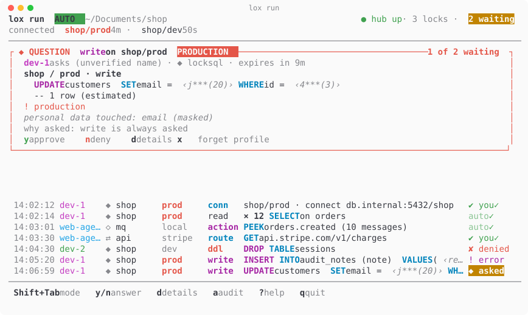

# lockhub

The approval hub of the [Lock Family](https://github.com/DavidGodefroid/lockfamily),
harness security for AI agents (locksql, lockmq, lockfile, lockhttp).

Each Lock keeps a human between an AI agent and a production system. With the
hub, a Lock no longer needs a human at its own terminal: it sends an approval
ticket (a masked screen of the request) to the hub, `lox run` decides it (the
auto mode's rules, or the human in its terminal; also `lox approve`, the lea
deck, Slack, Telegram or a paired phone), and the hub signs the decision. The Lock executes only on a signed
decision bound to the exact plan that was approved.

The hub never runs a request, never sees its results, and never sees values in
clear.

Chat facades (Slack, Telegram) show masked screens only and answer only non-
production reads and writes; production tickets and policy loosening are
answered in the terminal, the deck or a paired phone, unlocks and grants in
the terminal or the deck (`hub.Decide`, `internal/route`). A grant (risk
`grant`) is one approval for a bounded read scope (tables, duration, read
budget) that the lock then runs reads inside without a ticket each: `lox
approve` marks it and shows the lock's scope lines before the prompt, the
signed decision binds the scope's hash (`plan_hash`), and the hub's audit
records carry `"risk":"grant"`. The lock ends a grant (`:revoke`, end of
session, expiry); a revoke sent from the hub is not there yet. A production ticket is
flagged on every facade (`PRODUCTION` in `lox approve`, red and `· production`
on the phone, `flags.production` in the queue's ticket). `y` approves it: no current Lock sets
lockkit's `flags.retype`, so approving a production ticket needs no typed name.
The hub would ask for the instance name only on a ticket whose lock sets that
flag, in the terminal, the deck and on the phone alike (the hub checks it). The
queue's `retype` field gives the name to type, empty when none is needed, so
every facade applies the hub's rule. To approve many reads at
once, approve a grant: one decision for a read scope and a time window,
then the reads inside it need no ticket. A
workspace's `lockfamily.yaml` can narrow this routing, never widen it.

In `lox approve`, `o` (or Ctrl-O then Enter, where the terminal passes it:
not on macOS, which keeps ^O) shows a ticket's clear values:
the terminal sends an ephemeral key signed by its facade key (which every lock
pins, written by `lox run`), the lock seals the clear screen to it and signs
the answer, and only the terminal opens it. The hub relays ciphertext, and
never offers this on Slack, Telegram or mobile. An expired ticket is listed for
re-approval (`r`, approve again): the lock asks again, and when nothing changed
in the plan since then (and it is not for production) the hub approves it in
that one step; otherwise the new ticket shows what changed and waits for `y`.

Threat model of the facade socket: whoever can open it is the host's human (one
user). The facade name a client sends for `decide` and `renew` is self-declared
by that same user; a reveal is bound by the facade's own signed key, which the
lock checks against the key it pinned.

## lox run

`lox run` is the one terminal you keep open, **outside lea and any agent
harness**: an agent's own tool is never where its approvals are shown or
answered.


```sh
lox run              # in its own terminal, in the workspace (or a parent)
```

It starts (or reuses) the hub and the workspace's locks, then shows, live,
every message passing through the hub: each ticket (agent, lock, profile,
masked request), its decision (auto, you, denied, error) and its result (ran,
expired, withdrawn) — never a value in clear. Flow: agent → lock (socket) →
hub (masked ticket) → `lox run` → hub (signed decision) → lock → agent.

It runs in **auto mode** by default:

| Ticket | Auto mode |
|---|---|
| read (SELECT, MQ peek, file read) | approved by the rule, no question |
| locklog: a scan, an unmask, an approved lookup | as the profile's auto rules say (`auto`, `ask`, `deny`; locklog's default: asked), shown in the review |
| locksql write, DDL | asked, every time |
| connect (a lock opens a profile's connection on its agent's first request) | asked once per profile per `lox run` session; the password of an `ask` profile, or a Vault token that expired, is typed here and sealed to the lock |
| another profile | its own question, once per session |
| lockhttp: a new endpoint | asked once per session, then auto |
| dangerous MQ / file / HTTP actions | asked |
| policy loosening, grants, never-auto tickets, a production name to type | always asked |

A lock starts disconnected and closes an idle connection (lockkit `lazyconn`):
the next request asks again, and `lox run` approves it on the session's earlier
answer. **Shift+Tab** switches to manual (every ticket asked) and back; the mode
is the coloured badge in the header. The terminal **bell rings only when a
question waits**. A question is a framed card above the feed (`y` approve, `n`
deny, `d` the whole masked screen); masked values look like `‹j***(20)›`.
`a` shows the hub's audit, as `lox audit` lists it, `?` shows the keys. **Quitting** (`q q`, Ctrl-C) stops
serving decisions: pending and new tickets wait at the hub for the next `lox
run` (fail closed).

It respects `NO_COLOR`, reads a light background from `COLORFGBG` (or
`--theme light`), draws ASCII where the locale is not UTF-8, and redraws on
resize down to 40 columns; with stdout not a terminal it logs one plain line
per ticket. Light theme:



`lox audit` lists every exchange the hub keeps (each ticket and its answer,
masked by its lock, the rule or human that decided, its outcome) in the same
columns and colours, with filters (`--agent`, `--lock`, `--profile`,
`--since`, `--decision denied|human|auto|pending`, `--writes`), `--follow`
and `--json`; `lox audit show ID` draws one exchange: its masked plan, the
deciding rule, timings and signatures.

Each lock (but lockhttp, whose egress is its own policy) reaches only the
endpoints of its **reviewed** profile: its network is internal, and a small
gateway forwards to its database, broker or source, and its Vault when it has
`vault: true`, nothing else (no internet, no cloud metadata, no other host
port). The review shows the allowlist; `lox doctor` checks it. See
[docs/lox-run.md](docs/lox-run.md#egress-each-lock-reaches-its-reviewed-endpoints-only).

`lox up` is deprecated: it prints "use lox run" and only starts the hub and
the locks. See [docs/lox-run.md](docs/lox-run.md).

## Supported locks

| Lock | Source | `lox add` | Since |
|---|---|---|---|
| [locksql](https://github.com/DavidGodefroid/locksql) | PostgreSQL, MySQL, MariaDB, SQLite | `lox add locksql` | v0.11.0 |
| [lockmq](https://github.com/DavidGodefroid/lockmq) | RabbitMQ | `lox add lockmq` | v0.3.0 |
| [lockfile](https://github.com/DavidGodefroid/lockfile) | S3, SFTP, a local directory | `lox add lockfile` | v0.4.0 |
| [lockhttp](https://github.com/DavidGodefroid/lockhttp) | HTTP, through lea's gate | `lox add lockhttp` | v0.3.0 |
| [locklog](https://github.com/DavidGodefroid/locklog) | this host's log files, journal and containers; Loki, Elasticsearch, OpenSearch | `lox add locklog` | v0.2.0 |

"Since" is each lock's first release that runs under `lox run` (hub mode);
`lox run` upgrades a pinned image older than the release this lox ships
with. A locklog lock reads host logs through the mount plan its image
derives from the reviewed profile, bound read-only, and is answered on the
local facades only (its unmasks are `read-pii`): see
[docs/lox-run.md](docs/lox-run.md#locklog-the-mount-plan-and-the-containers-map).

## Status

Early development. This repository holds:

- `lockhub`: the hub server (`lockhub serve`), shipped as a cosign-signed image
  `ghcr.io/davidgodefroid/lockhub`, pinned by digest;
- `lox`: the host CLI (`lox run`, `lox approve`, `lox audit verify`, …),
  shipped in the same image and release, and as static archives
  (`lox_X.Y.Z_<os>_<arch>.tar.gz`, cosign-signed `checksums.txt`) that the
  Lock Family [install.sh](https://github.com/DavidGodefroid/lockfamily)
  installs into `~/.local/bin`. Each release tag also bumps the `lox` formula
  of the [Homebrew tap](https://github.com/DavidGodefroid/homebrew-tap):

  ```sh
  brew trust davidgodefroid/tap
  brew install davidgodefroid/tap/lox
  ```

  Homebrew asks you to trust a third-party tap once before it loads its
  formulas; trusting the whole tap also covers dependencies from it.

The ticket and decision formats live in
[lockkit](https://github.com/DavidGodefroid/lockkit) (`ticket` package), shared
with every Lock.

## First run

```sh
brew trust davidgodefroid/tap
brew install davidgodefroid/tap/lockfamily   # lea, lox and the Locks' launchers
lea                                          # starts lea; it runs no lox command
```

Then, in lea's projects directory, run `lox init` — or go straight to
`lox add locksql` — and keep `lox run` open in a terminal of its own: it
serves the decisions. Later, one source at a time, in that directory:

```sh
lox add locksql      # or lockmq, lockfile, lockhttp, locklog
lea stop             # a lock added while lea runs reaches it at lea's next start
lea
```

Without lea (`claude` on the host): `lox init` in the project, then
`lox add locksql`. Either way, keep `lox run` open in a terminal of its own:
it serves the decisions.

`lox init` asks nothing. It checks the prerequisites (Docker, cosign, lea,
the locks' launchers), lists the data sources the project's files name as
hints (`.env*`, `compose*.yaml`, `config/`: read only, never a secret),
writes a `lockfamily.yaml` with the hub alone and starts it, as `lox run` does. With no lock
declared yet, that first start asks no question (`--review` shows
everything and asks). It ends with a pointer to `lea` and to `lox add`.

`lox add TYPE` sets one source up, guided and applied at once: its
questions, the lock's `profile add`, `init claude` and `doctor`, the
declaration in `lockfamily.yaml`, a short review of that lock as it starts, and the
console's own questions at your terminal. A failure, a `n` or Ctrl-C keeps
nothing. Run it again for the next source; `lox remove NAME` takes one out.
See [docs/lox-add.md](docs/lox-add.md).

Where to run them: with lea, in lea's projects directory, not a project
inside it (lea reads `.lockfamily/up.json` only at the root of its projects
directory); with `claude` on the host, in the project or a parent (the
launchers walk up from the current directory to the nearest
`.lockfamily/up.json`). A lock added while lea runs reaches it at lea's next
start: `lea stop`, then `lea`.

See [docs/lox-init.md](docs/lox-init.md) for `lox init`.

[docs/lox-run.md](docs/lox-run.md) is the contract between `lox run` and lea;
[docs/design-notes.md](docs/design-notes.md) records where the code
deliberately departs from the hub's design plan.

## Mobile facade

A phone can approve tickets through an installable web app the hub serves.
Each decision taken on the phone is signed by the phone itself (a WebAuthn
credential, user verification required) over the decision and the lock's own
signed ticket, and every lock checks that signature against the phones it
pins: the hub's key alone cannot make a decision pass for one taken on the
phone. With `seal_clear`, each lock also seals its clear screen to the
paired phones (X25519, AES-256-GCM): the hub relays ciphertext only.

```yaml
hub:
  facades: [tty, deck, mobile]
  mobile:
    origin: https://hub.example.ts.net   # what the phone opens
    port: 8444                           # host loopback port (default)
    seal_clear: true                     # clear values, end to end to the phone
    require_device: [prod-write]         # locks refuse other approvals of these
locks:
  crm-prod:
    type: locksql
    image: ghcr.io/davidgodefroid/locksql@sha256:…
    devices: true                        # pins the paired phones (lockkit ≥ v0.4.0)
    reveal: true                         # Ctrl-O reveals on tty/deck (lockkit ≥ v0.5.0)
```

A lock without `devices: true` pins no phone: `lox run` routes it away from
mobile, and `seal_clear` and `require_device` do not apply to it (it takes the
hub's approvals from the other facades as before). The review names what each
lock does. Its image must take `--devices-file` (lockkit v0.4.0 or later).
For a lockhttp lock, lea's gate pins the devices, which `lox run` hands it in
`.lockfamily/up.json` (lockhttp v0.4.0 or later, lea v0.3.0 or later); when
lea cannot, it stops, says why, and says to run `lox run` (since lea v0.4.0
there is no standalone gate).
Likewise `reveal: true` pins the terminal's and the deck's facade keys in the
lock (`--facade-keys-file`, lockkit v0.5.0 or later), so `o`/Ctrl-O in `lox
approve` or lea's deck can show its clear screen; without it the lock refuses
reveals.

**Exposure.** `lox run` publishes the mobile listener on `127.0.0.1:8444`
only. The phone reaches it through a TLS reverse proxy or tunnel that you run
on the host and that forwards `origin` to that port: Tailscale Serve
(`tailscale serve --bg --https=443 http://127.0.0.1:8444`), Caddy, cloudflared,
… WebAuthn needs https, and the origin's host is the WebAuthn relying party.
The listener serves the web app and `/m/v1` only: never the lock API, never
the facade socket. The hub trusts no forwarded header; the origin comes from
`lockfamily.yaml`. The hub joins its own `mobile-hub` network for that port
(a bridge, so the hub container has a route out there; the lock API stays on
the internal `lockhub` network, which agents never join).

**Pairing.** `lox mobile pair --name phone` prints a one-time code (5 min,
wrong codes cancel it). Open the origin on the phone, enter the code,
register; then compare the fingerprint the phone shows (computed from its own
keys) with the one at the terminal and answer `y`. Run `lox run` to pin the
phone at the locks: `lox run` reviews the device like any key and recreates
the locks with it. `lox mobile list`, `lox mobile revoke NAME` (then `lox
up`). The confirmation is only as strong as the facade socket: whoever can
open it (your host account, never an agent container) can confirm a device.
`require_device` needs a paired device: `lox run` refuses it otherwise, so
revoking the last phone leaves the locks pinning it (the hub refuses it) until
you remove `require_device` and run `lox run`. `lox mobile pair` checks the
phone's origin against the one the last `lox run` applied.

**Routing.** The phone answers every risk class but `unlock` (no facade types
secrets yet) and `grant` (a wider approval than one read); production tickets need no typed name (no current Lock sets `flags.retype`); `hub.routing`
narrows it per instance.

**Limits.** The web app's code comes from the hub. A hub that serves
malicious code could ask you to verify yourself for another pending ticket of
the same lock than the one it shows, and could read the clear values sealed to
the phone while they are on screen. Locks still refuse anything not signed by
the phone over a ticket they signed themselves. A synced passkey also lives in
your platform account.

**Notifications.** Off by default: the app long-polls the queue while it is
open. With `hub.mobile.push: true`, the hub wakes the paired phones with Web
Push when a ticket they may answer (the same routing as the queue) becomes
pending: tap "Enable notifications" in the app, allow notifications, and the
browser's push subscription is recorded for that device (at most 4 per device;
dropped by `lox mobile revoke`, or when the push service answers 404/410).
Pushes carry no payload: the service worker shows "A Lock approval is pending"
and the app reads the ticket from the hub as usual. The hub signs each push
with VAPID (RFC 8292; its P-256 key `vapid.key` is created once in the hub's
data directory, 0600) and POSTs only to the known push services
(`fcm.googleapis.com`, `updates.push.services.mozilla.com`, `*.push.apple.com`,
`wns2-*.notify.windows.com`, https on the default port, public addresses only
(no private, loopback, CGNAT, NAT64 or other special-purpose ranges), no
redirects), at most one round per 30 s (`Topic` coalesces pushes queued for an
offline phone, `TTL` 30 min). The hub logs only the push service's host, never
an endpoint. `lox run` reviews the change and gives the hub its `egress-hub`
network for it. That network gives the hub general outbound access, as with
the chat facades: the restriction to the push services above is enforced by
the hub's code, not by the network. Signing out of the app keeps the device's
push subscription (it belongs to the device, not to the session): tap "Disable
notifications" before signing out to stop them on that phone, or revoke the
device. What remains exposed: the push service (Google, Mozilla, Apple,
Microsoft) learns when a ticket waits and which subscription is woken, though
nothing of the ticket.

```yaml
hub:
  mobile:
    origin: https://hub.example.ts.net
    push: true
```

## Build

```sh
go test ./...
docker build -t lockhub .
docker run --rm --read-only --cap-drop ALL lockhub version
```

## License

Apache-2.0, see [LICENSE](LICENSE).
