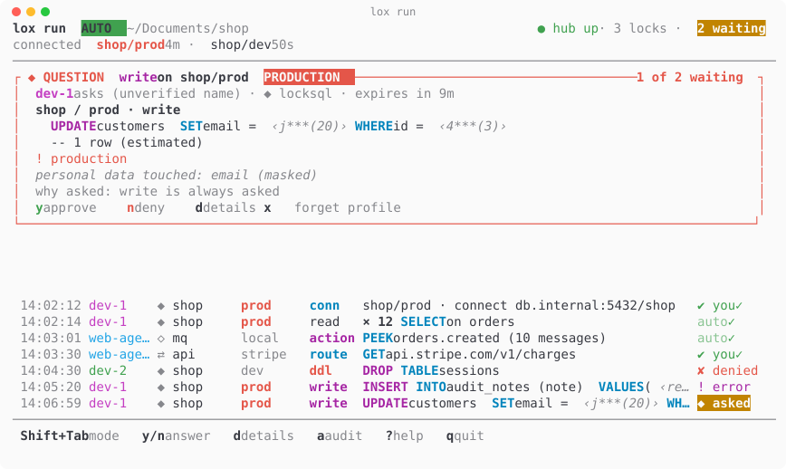

# How approvals work

How a Lock's request becomes a signed decision: the tickets, the facades
that answer them, grants, production tickets, reveals, and `lox run`'s
terminal. The README gives the short version; [lox-run.md](lox-run.md) is
the contract between `lox run` and lea.

## Tickets and facades

lockhub is the approval hub of the [Lock Family](https://github.com/DavidGodefroid/lockfamily),
harness security for AI agents (locksql, lockmq, lockfile, lockhttp, locklog).

Each Lock keeps a human between an AI agent and a production system. With the
hub, a Lock no longer needs a human at its own terminal: it sends an approval
ticket (a masked screen of the request) to the hub, `lox run` decides it (the
auto mode's rules, or the human in its terminal; also `lox approve`, the lea
deck, Slack, Telegram or a paired phone), and the hub signs the decision. The Lock executes only on a signed
decision bound to the exact plan that was approved.

The hub never runs a request, never sees its results, and never sees values in
clear.

Chat facades (Slack, Telegram) show masked screens only and answer only non-
production reads and writes; production tickets and policy loosening are
answered in the terminal, the deck or a paired phone, unlocks and grants in
the terminal or the deck (`hub.Decide`, `internal/route`). A grant (risk
`grant`) is one approval for a bounded read scope (tables, duration, read
budget) that the lock then runs reads inside without a ticket each: `lox
approve` marks it and shows the lock's scope lines before the prompt, the
signed decision binds the scope's hash (`plan_hash`), and the hub's audit
records carry `"risk":"grant"`. The lock ends a grant (`:revoke`, end of
session, expiry); a revoke sent from the hub is not there yet. A production ticket is
flagged on every facade (`PRODUCTION` in `lox approve`, red and `· production`
on the phone, `flags.production` in the queue's ticket). `y` approves it: no current Lock sets
lockkit's `flags.retype`, so approving a production ticket needs no typed name.
A ticket of an agent that does not run confined (lockkit#133: let in by a
non-production profile's `unconfined = true`) is flagged too: `UNCONFINED` in
`lox approve`, Slack and Telegram, `· unconfined` on the phone, the console's
banner on `lox run`'s card, `flags.unconfined` in the queue's ticket (omitted
when false).
The hub would ask for the instance name only on a ticket whose lock sets that
flag, in the terminal, the deck and on the phone alike (the hub checks it). The
queue's `retype` field gives the name to type, empty when none is needed, so
every facade applies the hub's rule. To approve many reads at
once, approve a grant: one decision for a read scope and a time window,
then the reads inside it need no ticket. A
workspace's `lockfamily.yaml` can narrow this routing, never widen it.

In `lox approve`, `o` (or Ctrl-O then Enter, where the terminal passes it:
not on macOS, which keeps ^O) shows a ticket's clear values:
the terminal sends an ephemeral key signed by its facade key (which every lock
pins, written by `lox run`), the lock seals the clear screen to it and signs
the answer, and only the terminal opens it. The hub relays ciphertext, and
never offers this on Slack, Telegram or mobile. An expired ticket is listed for
re-approval (`r`, approve again): the lock asks again, and when nothing changed
in the plan since then (and it is not for production) the hub approves it in
that one step; otherwise the new ticket shows what changed and waits for `y`.

Threat model of the facade socket: whoever can open it is the host's human (one
user). The facade name a client sends for `decide` and `renew` is self-declared
by that same user; a reveal is bound by the facade's own signed key, which the
lock checks against the key it pinned.

## lox run in the terminal

`lox run` is the one terminal you keep open, **outside lea and any agent
harness**: an agent's own tool is never where its approvals are shown or
answered.



```sh
lox run              # in its own terminal, in the workspace (or a parent)
```

It starts (or reuses) the hub and the workspace's locks, then shows, live,
every message passing through the hub: each ticket (agent, lock, profile,
masked request), its decision (auto, you, denied, error) and its result (ran,
expired, withdrawn) — never a value in clear. Flow: agent → lock (socket) →
hub (masked ticket) → `lox run` → hub (signed decision) → lock → agent.

It runs in **auto mode** by default:

| Ticket | Auto mode |
|---|---|
| read (SELECT, MQ peek, file read) | approved by the rule, no question |
| locklog: a scan, an unmask, an approved lookup | as the profile's auto rules say (`auto`, `ask`, `deny`; locklog's default: asked), shown in the review |
| locksql write, DDL | asked, every time |
| connect (a lock opens a profile's connection on its agent's first request) | asked once per profile per `lox run` session; the password of an `ask` profile, or a Vault token that expired, is typed here and sealed to the lock |
| another profile | its own question, once per session |
| lockhttp: a new endpoint | asked once per session, then auto |
| dangerous MQ / file / HTTP actions | asked |
| policy loosening, grants, never-auto tickets, a production name to type | always asked |

A lock starts disconnected and closes an idle connection (lockkit `lazyconn`):
the next request asks again, and `lox run` approves it on the session's earlier
answer. **Shift+Tab** switches to manual (every ticket asked) and back; the mode
is the coloured badge in the header. The terminal **bell rings only when a
question waits**. A question is a framed card above the feed (`y` approve, `n`
deny, `d` the whole masked screen); masked values look like `‹j***(20)›`.
`a` shows the hub's audit, as `lox audit` lists it, `?` shows the keys. **Quitting** (`q q`, Ctrl-C) stops
serving decisions: pending and new tickets wait at the hub for the next `lox
run` (fail closed).

It respects `NO_COLOR`, reads a light background from `COLORFGBG` (or
`--theme light`), draws ASCII where the locale is not UTF-8, and redraws on
resize down to 40 columns; with stdout not a terminal it logs one plain line
per ticket. Light theme:



`lox audit` lists every exchange the hub keeps (each ticket and its answer,
masked by its lock, the rule or human that decided, its outcome) in the same
columns and colours, with filters (`--agent`, `--lock`, `--profile`,
`--since`, `--decision denied|human|auto|pending`, `--writes`), `--follow`
and `--json`; `lox audit show ID` draws one exchange: its masked plan, the
deciding rule, timings and signatures.

Each lock (but lockhttp, whose egress is its own policy) reaches only the
endpoints of its **reviewed** profile: its network is internal, and a small
gateway forwards to its database, broker or source, and its Vault when it has
`vault: true`, nothing else (no internet, no cloud metadata, no other host
port). The review shows the allowlist; `lox doctor` checks it. See
[lox-run.md](lox-run.md#egress-each-lock-reaches-its-reviewed-endpoints-only).

`lox up` is deprecated: it prints "use lox run" and only starts the hub and
the locks. See [lox-run.md](lox-run.md).
